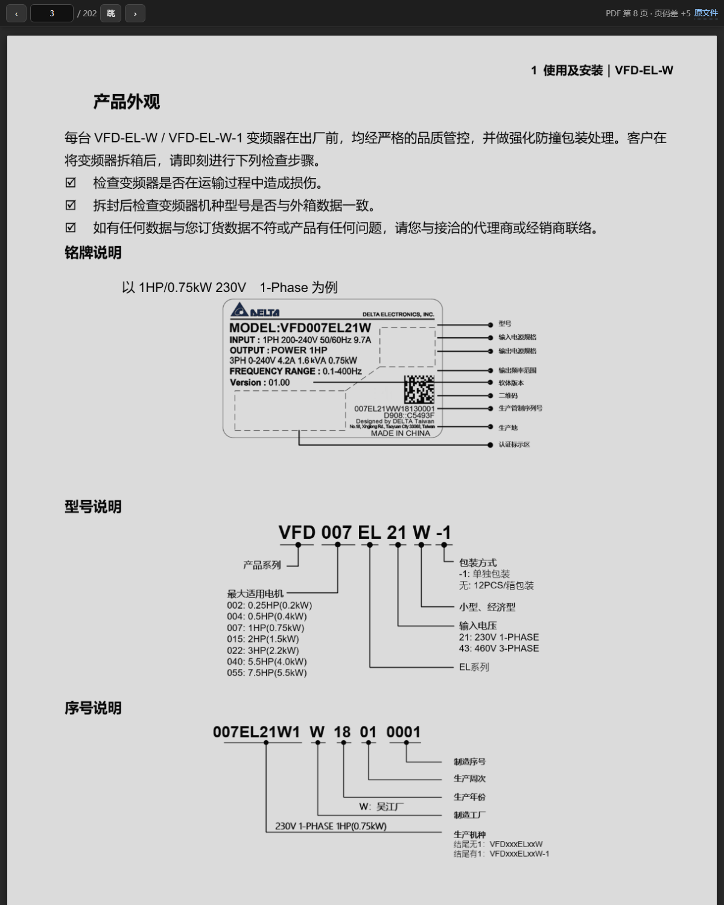

# dsh-pdf-jump

**中文** | [English](README.en.md)

在 DSH 侧栏里看本地 PDF。一个包装两个独立工具，装一次两个都可用：

- **`pdf-open`**：用 DSH **原生的 PDF 预览**打开（客户端直接渲染，不生成图片、不起本地服务），是最快的打开方式，适合「打开看一眼、滚动读」。
- **`pdf-view`**：本地把页面渲染成图，适合**按页码跳**和**整本浏览**——整本页先出缩略图、滚到哪页换高清，页顶还能输入页码直接跳；不依赖原生预览，任何 profile 都能用。

页码按 **PDF 页序**（1 = 文件第一页）。不从页脚推断印刷页码：手册常把全书页码和「章-页」编号混着用，猜出来的差值会把正文页整体错位。



## 安装

```sh
dsh plugin --profile web add dsh-pdf-jump
```

还没发布到 npm 时，直接从 GitHub 装：

```sh
dsh plugin --profile web add github:taoziliyouchong/dafeiyu_dsh_pdf_jump
```

然后重启 DSH。用别的 profile 就把 `web` 换成你的 profile 名。同一个包也在社区插件市场（awesome-dsh-plugin / dshmarket）里。

装好后除了两个工具，还会注册一个 `/pdf` 命令：`/pdf 繁易手册 300` 直接出链接，不经过模型判断。

要求：DSH 带宿主 `tools` 与 `systemPrompt` 服务（普通基础组合都含），Node 22.19+ 或 24+。

## 用法

| 你说 | 用哪个工具 |
| --- | --- |
| 打开某本 PDF 看看 / 滚动读 | `pdf-open` |
| 跳到某本手册第 N 页 | `pdf-view`（page = PDF 页序） |
| 整本一页页翻 | `pdf-view` 的「整本浏览」 |
| 在整本里跳到某页 | 整本页顶部输入页码，或地址带 `#p40` |
| 不让模型判断、直接开 | `/pdf <文件或片段> [页码]` |
| 提取文字 / 读元数据 | `dsh-pdf` 的 `pdf_info` / `pdf_extract_text` |

两个工具都接受绝对/相对路径或文件名片段（如 `NB系列 安装手册`）；相对路径按会话工作目录解析。结果都会显示成一条可点的文档行，`pdf-open` 指向文件本身（由侧栏原生预览打开），`pdf-view` 指向本地查看页。

## 机制

- `pdf-open` 只解析路径并返回文件路径，交给 `sidebar_open`；渲染完全由 DSH 客户端完成。
- `pdf-view` 的本地 HTTP 服务只绑 `127.0.0.1`，端口从 8731 往上试，复用别的 DSH 进程已起的服务；插件一加载就启动，整个 DSH 会话期间常驻（`idleMinutes: 0`），旧对话里的链接不用重新生成。
- `pdf-view` 用 `pdfjs-dist` + `@napi-rs/canvas` 把页面渲成 PNG 缓存在系统临时目录；工具一调用先暖请求页和前后各 2 页，打开后以当前页为中心向两边各暖 6 页，已缓存的页直接读盘、不进渲染队列。
- 整本浏览先用 0.8 倍 JPEG 缩略图铺满（每页十几毫秒），滚到哪页再把那页换成全尺寸 PNG；每一页都有锚点（`#p40`），整本页顶部输入页码即滚到该页。
- `/pdf` 命令和工具走同一套逻辑：带页码走 `pdf-view`，不带页码走 `pdf-open`。
- 查看地址是短路径（`/v/<id>/<页>`、`/d/<id>`、`/p/<id>/<页>.png`、`/t/<id>/<页>.jpg`），不带查询串；id 通过系统临时目录里的小注册表映射到文件。配合「插件加载即启动、端口固定」，DSH 重启后旧对话里的链接也能重新打开。
- 不上传任何内容。

## 配置

可选，写在 profile 的 patch 行里（只影响 `pdf-view`）：

```yaml
- id: dsh-pdf-jump
  name: dsh-pdf-jump
  config:
    port: 8731
    scale: 2
    idleMinutes: 0
    prefetch: true
    prefetchWindow: 6
    roots:
      - D:/manuals
```

| 字段 | 默认 | 含义 |
| --- | --- | --- |
| `port` | `8731` | 起始端口；被占用或已有同款服务时自动向上找 |
| `scale` | `2` | 渲染倍率，2 约等于 144 dpi |
| `idleMinutes` | `0` | 空闲多少分钟后关掉服务；`0` 表示整个 DSH 会话常驻 |
| `prefetch` | `true` | 是否在后台暖当前页附近的页面 |
| `prefetchWindow` | `6` | 当前页两侧各暖多少页 |
| `roots` | `[]` | 文件名片段搜索的额外根目录 |

环境变量 `PDF_JUMP_ROOTS` 也可以加搜索根，按平台的路径分隔符分隔（Windows 是 `;`，其他是 `:`）。

## 限制

- `pdf-open` 依赖 DSH 自带的原生 PDF 预览；没有该预览的环境用 `pdf-view`。
- `pdf-view` 的页面是图片：不能选文字，也不能全文搜索；要文字用 `dsh-pdf` 的 `pdf_extract_text`。
- 渲染依赖 `@napi-rs/canvas` 的预编译二进制，覆盖 Windows / macOS / Linux 的 x64 与 arm64。

## 打不开时

- **侧栏空白或提示「已阻止」**：应用内侧栏浏览器默认拦截本机回环地址。把 `127.0.0.1:8731`（及 8732–8750 中实际用到的）加进侧栏设置的「允许访问的本机地址」，或把「设置 → 通用 → 网页链接默认打开方式」改成「默认浏览器」。
- **旧对话里的链接提示「拒绝连接」**：要么端口被别的程序占了导致换了端口，要么 PDF 文件被移动/删除。重新调用一次工具取新地址；`pdf-open` 返回的文件路径不受影响。

## 许可

MIT
